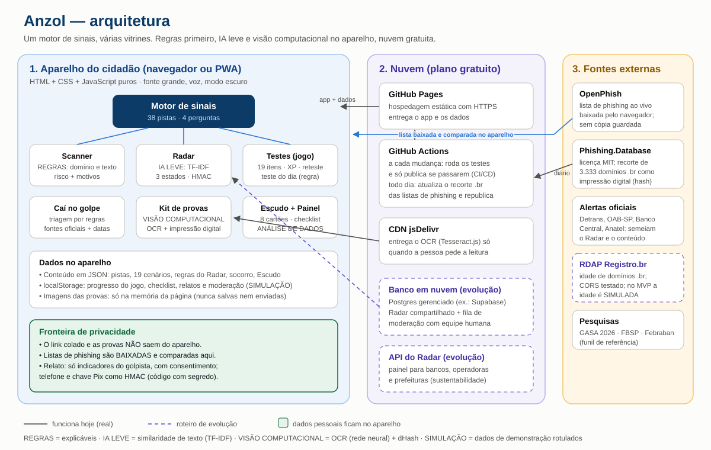

# Arquitetura do Anzol



> Versão 0.1 · 06/11/2026. Linha cheia = funciona hoje · tracejada = roteiro de evolução · **SIMULAÇÃO** = dados de demonstração rotulados.

## 1. As três camadas

| Camada | O que roda ali | Por quê |
|---|---|---|
| **Aparelho do cidadão** (navegador/PWA) | Todo o app: motor de sinais, Scanner, Radar, Testes, Caí no golpe, Kit de provas, Escudo, Painel | **Privacidade** (o link e as provas não saem do aparelho) e **custo zero** por uso |
| **Nuvem** (gratuita) | GitHub Pages (hospedagem HTTPS), GitHub Actions (testes + publicação + atualização diária das listas), CDN jsDelivr (OCR sob demanda) | Disponível para qualquer pessoa, atualizado automaticamente, sem servidor para manter |
| **Fontes externas** | OpenPhish (ao vivo), Phishing.Database (recorte .br), alertas oficiais (Detrans, OAB, BC, Anatel), RDAP Registro.br (evolução), pesquisas (GASA, FBSP) | Golpes brasileiros **reais e atualizados** |

## 2. As 4 tecnologias obrigatórias — onde aparecem de verdade

| Tecnologia | Onde | Técnica | Real ou simulado |
|---|---|---|---|
| **Visão computacional** | Kit de provas | OCR (Tesseract.js, rede neural LSTM) no aparelho + correção de erros típicos; impressão digital de imagem (dHash 9×8) para reconhecer o mesmo print reenviado | **Real** (comprovante de exemplo lido em ~2 s; reenvio comprimido reconhecido com distância 6/64) |
| **Inteligência artificial** | Radar | Agrupamento de variantes por similaridade de texto (trigramas + TF-IDF + cosseno) e de domínio | **Real** em escala pequena, sobre campanhas de demonstração (**SIMULAÇÃO**) |
| **Análise de dados** | Painel | Funil de referência (GASA 2026, **real**), relatos por dia/UF/tipo, saúde do Radar, evolução teste inicial × reteste, pistas mais deixadas passar, tempo até falar com o banco | Funil real; Radar com dados **SIMULADOS**; indicadores pessoais do aparelho |
| **Cloud** | Publicação e atualização | GitHub Pages + GitHub Actions (CI/CD: só publica se os testes passarem; agendamento diário atualiza as listas de phishing) + CDN | **Real** (após a publicação) |

**Seja explícito no vídeo:** Scanner, estados do Radar, teste do dia e triagem de socorro são **regras** (explicáveis), não IA.

## 3. Fluxo do caminho completo (o que o vídeo mostra)

```
Mensagem suspeita
  └─► Scanner (no aparelho): regras de domínio e texto → risco + motivos
        ├─► Listas públicas: OpenPhish (baixada ao vivo) + recorte Phishing.Database → comparação no aparelho
        └─► Radar: comparação exata (domínio; telefone/Pix por HMAC) e parecida (IA leve)
              ├─ campanha conhecida → "reportada por N pessoas · alerta ativo" (alerta passivo)
              └─ nova → relato em um toque (prévia + consentimento) → fila de moderação (SIMULAÇÃO)
                     └─► campanha aprovada → rascunho de teste → (após revisão) entra no jogo
  └─► "Já cliquei ou paguei" → Caí no golpe → plano por urgência → Kit de provas (OCR) → rascunho para banco/BO
```

## 4. Privacidade por desenho

- O endereço colado no Scanner **nunca é enviado**: as listas são baixadas e comparadas no aparelho; o Scanner **nunca abre** o link.
- Provas (prints) ficam **só na memória da página**; OCR roda no aparelho (o que vem da internet é o programa de leitura, não a imagem).
- Ao Radar vai **só o indicador do golpista**, com prévia e consentimento; telefone e chave Pix como **HMAC com segredo** (no protótipo o segredo é de demonstração; em produção fica só no servidor).
- Indicadores expiram (30 dias sem relato) e podem ser contestados; telefone/Pix exigem revisão humana; número de ligação nunca gera alerta.
- Base legal (LGPD): legítimo interesse para prevenção à fraude (art. 7º, IX) — **premissa que precisa de validação jurídica**.

## 5. Custos e limites (verificados)

| Serviço | Plano | Limite relevante | Fonte (verificado em) |
|---|---|---|---|
| GitHub Pages | gratuito (repositório público) | site até 1 GB; 100 GB/mês de tráfego (limite flexível); não é para negócio comercial | docs.github.com — Pages limits (05/11/2026) |
| GitHub Actions | gratuito em repositório público (runners padrão) | máquinas maiores são cobradas | docs.github.com — Actions billing (06/11/2026) |
| jsDelivr | gratuito | CDN pública para pacotes npm | — |
| Supabase (evolução) | gratuito | 500 MB; 2 projetos; **pausa após 1 semana sem uso** | supabase.com/pricing via fontes secundárias (05/11/2026) |

**Custo por cidadão no MVP: zero** — todo o processamento roda no aparelho.

## 6. Evolução (roteiro)

1. **Radar compartilhado** em banco gerenciado (Postgres/Supabase) com moderação humana real e segredo do HMAC só no servidor.
2. **RDAP real** do Registro.br para idade de domínios `.br` (CORS já testado).
3. **API/painel do Radar** para bancos, operadoras e prefeituras (modelo de sustentabilidade: gratuito para o cidadão).
4. Notificação ativa só para campanhas de alta confiança; novos golpes (voz clonada, investimento).
